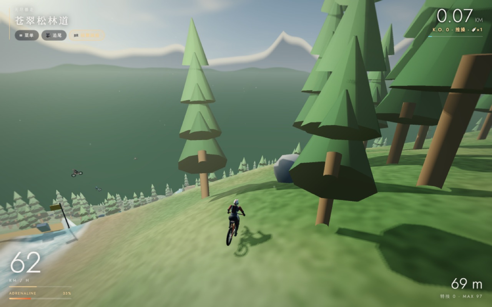
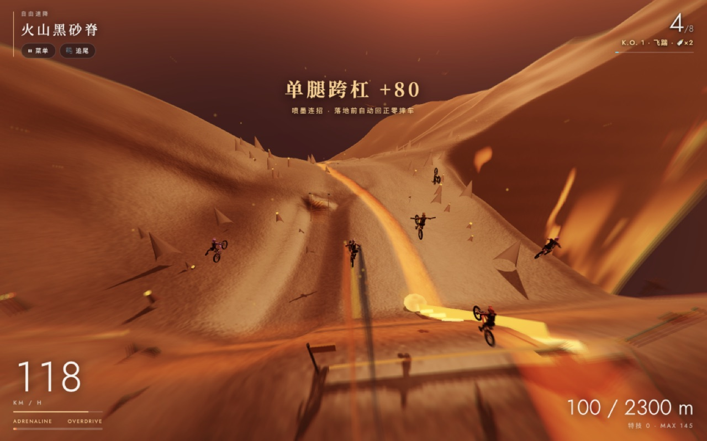
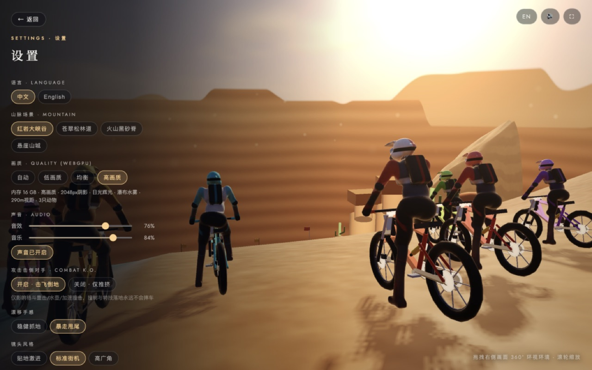

<div align="center">

# 暴走速降 · CrazyBike

**A pure-code, zero-asset 3D arcade downhill mountain biking & combat game in one HTML file.**

**一个 HTML 文件里的纯代码 3D 暴走速降山地车竞速与格斗游戏，画面与声音全部由代码实时生成。**

[**▶ Play in your browser / 在线试玩**](https://crazybike.yepw.dev) · [English](#english) · [中文](#中文)


</div>

---

## English

**CrazyBike** is an open-mountainside 3D downhill mountain biking game inspired by PS2 *Downhill Domination* and the pure-code WebGPU/WebGL2 architecture of [huiskylabs/cold-smoke](https://github.com/huiskylabs/cold-smoke) (MIT). Carve open slopes at 130+ km/h, send random 6–66 m cliff drops beside waterfalls and creeks, pull mid-air ink-brush stunt chains, and trade paint or knock rivals down on the way to the finish arch.

What makes this repository unusual is what it **does not** contain:

- **Zero runtime image, audio, 3D model, or texture files.** The terrain, canyons, pine woods, volcanoes, articulated full-suspension bikes, skinned riders, wildlife, waterfalls, wind roar, tire gravel crunch, and Lo-Fi jazz soundtrack are all generated at runtime by ~9,800 lines of plain JavaScript and shaders across 28 modules.
- **One self-contained HTML file (~311 KB minified).** `build.js` concatenates `src/*.js` directly into `template.html`. Zero bundlers, zero frameworks, zero npm runtime dependencies (only two optional Google Web Fonts in `template.html` for UI typography, while images in `docs/media/` are strictly for this README).
- **WebGPU first, WebGL2 fallback.** Shaders are written once in a WGSL subset (`src/02_shaderlib.js`) and translated automatically to GLSL ES 3.00 (`src/01_gfx.js`).

| | |
|---|---|
|  |  |
|  |  |

### Features

- **4 Procedural Theme Mountains**: Red Rock Canyon (红岩大峡谷), Pine Forest (苍翠松林道), Volcanic Ridge (火山黑砂脊), and Hillside Town (悬崖山城), each with freeride line choice, shortcuts, U-halfpipes, flowing creeks, cascading cliff waterfalls, and random 6–66 m step-down drops.
- **Career Tour, 3D Garage & Boundary-Free Endless Mode**: 12 Career events across Freeride, Technical, and Mountain Cross, live 3D visual bike upgrades & liveries, plus a borderless infinite-width Endless slope with **Today's Mountain** (`#today`) and shareable `#seed-xxxxxx` links.
- **SDF-Sculpted Rider & True-Geometry DH MTB**: 23-bone skinned rider articulated at startup from signed distance fields, paired with dual-crown forks, 8-spoke wheels, brake rotors, rear derailleur, and high-cadence sprint pedaling.
- **Airtime-Budgeted Stunts & Ink-Brush Trails**: Calculates expected airtime on takeoff to chain complete random tricks cleanly before landing with zero landing crashes, trailing painterly organic ink strokes.
- **Adaptive Skill + Upgrade AI Matchmaking**: 7 distinct AI rivals dynamically match both your current Garage upgrade level and persistent Career skill rating, spanning slightly stronger challengers, closely matched pack peers, and trailing riders.
- **Configurable Combat Knockdowns + Crash-Free Obstacles**: Hitting rocks or trees always triggers a smooth lateral dodge instead of abrupt wipeouts, while melee strikes, thrown water bottles/wrenches, and boost-rams can be toggled in Settings between full **Ragdoll K.O.** (`开启`) and **Shove Only** (`关闭`).
- **Memory-Aware Quality System (`Auto / Low / Balanced / High`)**: Reads `navigator.deviceMemory`, CPU cores, and GPU renderer to scale resolution cap, 512–2048 px shadow maps, sunlit bloom/glare, particles/waterfall mist, draw distance, and wildlife count — with a live hardware & visual feature breakdown in Settings.
- **Calibrated Binaural Audio & Warm Lo-Fi Score**: Multi-layer Web Audio pink-noise wind roar, spoke whistle, gravel roll, freewheel hub clicks, and a warm Rhodes 9th-chord Lo-Fi groove.
- **8 Camera Views, 360° Orbit & Freeze-Frame Photo Mode**: Switch chase, close, hero, fork/fender, FPV helmet (with head geometry culling), helicopter, or side views (`V` / `1–8`), drag right to orbit 360°, or press `P` to freeze the world and compose a shot.

### Controls

| Context | Action | Keyboard | Gamepad / Touch |
| :--- | :--- | :--- | :--- |
| Ground | Steer & Carve | `A / D` or `← / →` | Left Stick / Drag |
| Ground | Sprint Pedal | `W` or `↑` | `RT` |
| Ground | Brake / Rear Drift | `S` or `↓` | `LT` / Drift button |
| Ground | Charge & Jump | Hold `Space`, release | Hold `A` (`×`), release |
| Ground | Adrenaline Overdrive | `Shift` | `RB` or `Y` |
| Ground | Left / Right Melee or Bottle/Wrench Throw | `Q / E` or `J / K` | `LB / X` · `B` |
| Mid-Air | Sequential Random Ink Stunt Chain | `WASD` / Arrows / `Space` | Stick + Stunt |
| Camera / UI | Switch Camera View | `V` / `Shift+V` / `1–8` | `View` / Camera pill |
| Camera / UI | Pause / 360° Orbit / Photo Mode | `Esc` · Right-Drag · `P` | `Menu` / Pause → Photo |

### Run it locally

Requires [Node.js](https://nodejs.org) 18+ and any browser supporting WebGPU or WebGL2.

```bash
git clone https://github.com/jeffierw/crazybike.git
cd crazybike
npm start          # builds dist/ and serves http://localhost:8080
```

Useful scripts and URL parameters:

- `MIN=1 npm run build` — build minified standalone `dist/index.html` and unminified `dist/dev.html`
- `npm run verify` — run the headless 18-check suite (WGSL+GLSL shaders, SDF mesh, 4-mountain sim, stunts, adaptive AI, quality & knockdowns)
- URL parameters: `?backend=webgl2`, `?lang=en` or `?lang=zh`, `?quality=auto|low|balanced|high`, `?dev`, plus `#today` or `#seed-123456`

### Project structure

```text
src/                  28 modules concatenated in filename order into dist/index.html
  00_util.js          math, deterministic RNG, hashes, matrix helpers
  00a_i18n.js         browser-language detection & live ZH/EN localization
  00b_variants.js     live feel & wind preset switches
  00c_quality.js      memory/GPU-aware quality detector (Auto / Low / Balanced / High)
  01_gfx.js           dual WebGPU + WebGL2 backend & WGSL-to-GLSL translator
  02_shaderlib.js     shared uniforms, sky/fog, noise & shadow sampling library
  03_course.js        4-biome procedural mountains, cliffs, waterfalls, creeks, 2D endless obstacles
  04_terrain.js       chunked LOD terrain mesh & PBR procedural material shader
  05_sky.js           biome sky domes, clouds, distant mesas/peaks/volcanoes & bays
  05b_sdfmesh.js      runtime SDF surface mesh builder for articulated riders
  06_bikemesh.js      23-bone skinned DH rider + dual-suspension bike & upgrade visuals
  07_physics.js       arcade DH physics, obstacle dodge, stunt landings & combat knockdowns
  07b_camera.js       8 slope-adaptive cameras, FPV lensCut & 360° orbit
  07c_feel.js / 07d_stunts.js   camera dynamics & airtime-budgeted sequential stunt engine
  08_ai.js            adaptive upgrade+skill AI pack & endless traffic recycler
  09_combat.js        melee punches/kicks/bats, homing bottles/wrenches & boost rams
  09_post.js          shadow map pass, sunlit bloom/glare & speed radial blur
  10_particles.js     sunlit dust plumes, waterfall mist & ink-brush stunt ribbons
  14_props.js / 15_wildlife.js   landmarks, vegetation, waterfalls & sparse biome wildlife
  18_sound.js / 18b_music.js     synthesised binaural wind, gravel SFX & Lo-Fi Rhodes score
  19_career.js / 19b_postcard.js / 19d_photo.js / 19_ui.js   career, route card, photo mode & HUD
  99_main.js          main loop, state machine & inspection hook
template.html         editorial typography, styling & shell into which build.js injects src/*.js
build.js              single-file compiler producing dist/index.html & dist/dev.html
tools/                serve.js (local preview) & verify-mvp.js (headless verification)
docs/media/           lightweight JPEGs used in this README showcase
```

### Credits & License

[MIT](LICENSE). Rendering abstraction (`src/01_gfx.js`), memory-aware quality scaling, and pure-code single-file philosophy are inspired by [huiskylabs/cold-smoke](https://github.com/huiskylabs/cold-smoke) (MIT), paired with arcade downhill combat homage to *Downhill Domination*.

---

## <a id="中文"></a>中文

**暴走速降（CrazyBike）** 是一款纯代码生成、零外部资源依赖的 3D 街头暴走速降与山地车格斗游戏，灵感来自 PS2 经典《暴走山地自行车》（*Downhill Domination*）以及 [huiskylabs/cold-smoke](https://github.com/huiskylabs/cold-smoke)（MIT）的纯代码单文件架构。

它特别的地方在于仓库里**没有**任何图片、音频或 3D 美术资源（`docs/media/` 仅用于本 README 展示）：

- **零外部运行时资源：** 山脉地形、6–66 米随机险峻断崖、悬崖瀑布与山间小溪、U 形坡、23 骨骼 SDF 蒙皮车手、双避震山地车、野生动物、风噪、胎噪与 Lo-Fi 配乐全部由 28 个模块约 9,800 行原生 JavaScript 与着色器在运行时实时生成。
- **单文件极简产物（约 311 KB）：** 构建脚本直接把 `src/*.js` 拼入 `template.html` 生成 `dist/index.html`，无打包框架、无 npm 运行时依赖。
- **WebGPU 优先，自动回退 WebGL2：** 着色器仅用 WGSL 子集编写一遍，运行环境不支持 WebGPU 时自动翻译为 GLSL ES 3.00 执行。

### 特性亮点

- **四座主题大山：** 红岩大峡谷、苍翠松林道、火山黑砂脊、悬崖山城，全部采用无空气墙开放路线（含多条抄近道、U 形槽、流动小溪、熔岩河与断崖瀑布）。
- **生涯巡回、3D 改装车库与无限无尽模式：** 4 山脉 × 3 赛制共 12 场生涯赛事；车库改装会实时反映在 3D 车架、避震金管、宽胎与武器上；无尽模式取消横向边界，支持无限延展山坡、`#today` 每日全球同山以及 `#seed-xxxxxx` 种子分享，且默认单人独享流畅速降（也可一键开启 AI 混战）。
- **空中连续喷墨特技：** 根据起跳预计滞空时间自动计算动作容量，先完整做完当前动作再衔接下一个（高空断崖可接 360° 后空翻），伴随有机水墨/喷漆彩带，落地自动回正 **永不摔车**。
- **动态匹配实力的 AI 阵容：** AI 会根据你的改装平均等级与历史战绩实时匹配强度，7 位对手中自动形成“略强领跑 + 实力相近缠斗 + 略弱垫后”的真实竞赛梯队，告别零改装打不过或满改后毫无悬念的问题。
- **可开关的格斗击倒系统 + 零摔车撞障：** 撞到岩石或树木永远改为丝滑侧向闪避；而近战推踹/球棒、水壶投掷和肾上腺素撞击可在设置中自由切换 **「攻击击倒对手：开启（击飞倒地后快速复活）」** 或 **「关闭（仅侧推挤）」**。
- **内存感知画质系统（自动 / 低画质 / 均衡 / 高画质）：** 自动探测设备内存（`navigator.deviceMemory`）、CPU 核心数与 GPU 型号，动态缩放分辨率、512–2048px 阴影贴图、日光辉光、瀑布水雾、粒子密度、视距与野生动物数量，并在设置中实时展示检测到的内存与对应画面细节。
- **Cold Smoke 标定声学混音：** 柔和自然的双耳粉红噪声山风，搭配温暖清澈的 Lo-Fi Rhodes 电钢爵士鼓点配乐。
- **8 种自适应机位与定格拍照：** 随坡度自动抬高俯角的追尾/低伏/贴脸/前叉/头盔第一视角，支持右键 360° 环视及 `P` 键定格拍照与战报明信片 PNG 导出。

### 操作说明

| 场景 | 动作 | 键盘 | 手柄 / 触屏 |
| :--- | :--- | :--- | :--- |
| 地面 | 左右转向压弯 | `A / D` 或 `← / →` | 左摇杆 / 拖动 |
| 地面 | 全力蹬车冲刺 | `W` 或 `↑` | `RT` |
| 地面 | 刹车 / 暴走甩尾漂移 | `S` 或 `↓` | `LT` / 甩尾键 |
| 地面 | 蓄力起跳 | 按住 `Space`，松开起跳 | 按住 `A` (`×`) 松开 |
| 地面 | 肾上腺素暴走加速 | `Shift` | `RB` 或 `Y` |
| 地面 | 左右格斗 / 投掷水壶与扳手 | `Q / E` 或 `J / K` | `LB / X` · `B` |
| 空中 | 连续随机喷墨特技（零摔车） | `WASD` / 方向键 / `Space` | 摇杆 + 特技 |
| 镜头与菜单 | 切换 8 种机位 | `V` / `Shift+V` / `1–8` | 机位键 |
| 镜头与菜单 | 暂停 · 360° 环视 · 拍照 | `Esc` · 右键拖拽 · `P` | 菜单 / 暂停拍照 |

### 本地运行与验证

需要 [Node.js](https://nodejs.org) 18+ 以及支持 WebGPU 或 WebGL2 的现代浏览器：

```bash
git clone https://github.com/jeffierw/crazybike.git
cd crazybike
npm start          # 构建并启动 http://localhost:8080
```

- 压缩构建：`MIN=1 npm run build`
- 自动化校验：`npm run verify`（验证 WGSL/GLSL 着色器、SDF 车手网格、四山脉物理与闪避、特技连招、动态 AI 与画质/击倒开关）
- 常用 URL 参数：`?backend=webgl2`、`?lang=zh` / `?lang=en`、`?quality=auto|low|balanced|high`、`#today`、`#seed-123456`

### 开源协议

[MIT License](LICENSE)
