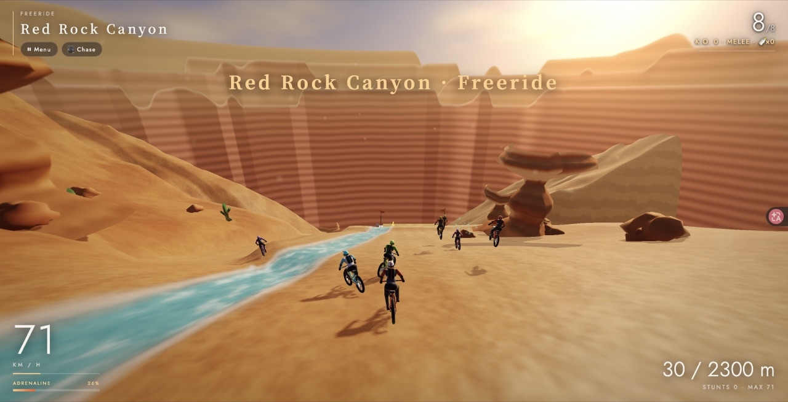
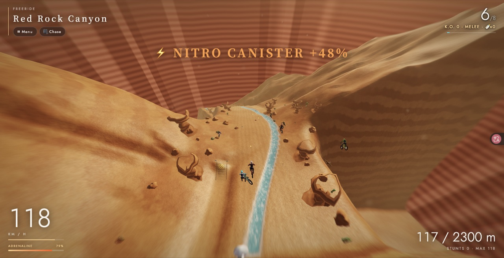

<div align="center">

<h1>CRAZYBIKE · Downhill Mayhem</h1>

<p><strong>A single-file WebGPU &amp; WebGL2 procedural downhill mountain biking game — sculpted canyons, endless alpine trails, cliff drops, ink-ribbon aerial stunts, pickup-driven nitro/water-bottle combat, and live 3D camera inspection.</strong></p>

<p>
  <a href="https://crazybike.yepw.dev"><strong>Play Live (crazybike.yepw.dev)</strong></a>
  &nbsp;·&nbsp;
  <strong>English</strong> | <a href="README.zh-CN.md">中文</a>
</p>

<p>
  
  
  
  
</p>



</div>

---

## Highlights

- **Dual GPU Engine (`WebGPU` + `WebGL2`):** Single-source typed shader language (SSL) compiled at boot to both WGSL and GLSL ES 3.00 with crisp PCF directional shadows, volumetric sky scattering, ACES filmic tone mapping, bloom, and speed-adaptive atmospheric haze.
- **4 Sculpted Procedural Biomes:**
  - **Red Rock Canyon** — Stepped sandstone mesas, sculpted hoodoos, fluted saguaros, canyon creeks, and massive stratified cliff drops.
  - **Pine Forest** — Jagged snow-capped granite peaks, valley cloud seas, drooping layered conifer boughs, boulders, and endless boundary-free mountain freeride.
  - **Volcanic Ridge** — Smoking caldera crest with lava rim glow, glowing magma channels, and jagged basalt spires.
  - **Hillside Town** — Mediterranean headlands, gleaming sunlit ocean waves, pitched-roof coastal villas, terraced stone steps, and soaring gulls.
- **Pickup-Driven Combat & Biomechanical Melee:**
  - Randomly spawned **Nitro Canisters** and **Water Bottles** along ramps, cliffs, and open lines replace infinite ammo refills.
  - Thrown water bottles home onto targets only within bounded range (`≤ 26 m`). Out of pickups, pressing attack performs a randomized **Human Punch** or **Flying Kick** with custom 3-phase skeletal kinematics and distinct audio cues.
  - **Strict Knockdown Rules:** Normal high-speed bumps trade paint safely; ragdoll knockdowns occur strictly from **Flying Kicks** or **Water Bottle** hits (plus a Settings toggle for casual freeride), with guaranteed upright recovery (`resetRiderPoseState`) on respawn.
- **Zero-Crash Chained Stunts & Ink Ribbons:** Queue tricks continuously across massive drops (`dblcancan → whip → backflip → cancan`) with tapered brushstroke ink ribbons trails and no accidental mid-trick switches or infinite post-landing bounce loops.
- **Live 3D Camera Preview & 8 Views:** Selecting any of the 8 camera rigs (`Chase`, `Low`, `Helmet FPV`, `Front Fork`, `High`, `Left`, `Right`, `Front`) immediately updates the 3D scene behind the menu and displays a live preview status badge. Helmet FPV automatically hides head geometry to guarantee zero visor clipping.
- **Interactive Scenery & Wildlife:** Brushing trackside flora, rocks, and boulders triggers damped spring-sway animation, biome debris bursts, and material-specific impact audio without cheap instant crashes. Sparse biome wildlife (soaring hawks/gulls and galloping deer/bighorn) roam off-line.
- **Memory-Aware Quality & Adaptive AI:** Automatically detects GPU/RAM/hardware threads (`Auto → Low / Balanced / High`, adjustable on pause or title) and dynamically paces 7 AI rivals (`strong / match / weak`) around your bike upgrades and sliding skill rating.
- **Atmospheric Lo-Fi Audio Engine:** Web Audio synthesizer mixes warm Lo-Fi chill tracks, subtle tire/wind rush, stunt chimes, pickup pings, and biomechanical punches/kicks.

---

## World & UI Gallery

<table>
  <tr>
    <td width="50%">
      
      <p align="center"><strong>Red Rock Canyon</strong> — Sculpted hoodoos, desert shrubs &amp; pickup canisters</p>
    </td>
    <td width="50%">
      
      <p align="center"><strong>Pine Forest</strong> — Endless freeride through drooping conifers &amp; snow-capped peaks</p>
    </td>
  </tr>
  <tr>
    <td width="50%">
      
      <p align="center"><strong>Volcanic Ridge</strong> — Smoking caldera glow, basalt spires &amp; magma streams</p>
    </td>
    <td width="50%">
      
      <p align="center"><strong>Hillside Town</strong> — Coastal villas, sunlit ocean shimmer &amp; soaring seabirds</p>
    </td>
  </tr>
</table>

<p align="center">
  
  <br>
  <em>Live 3D camera switching with right-hand active preview readout and Helmet FPV auto-cut</em>
</p>

---

## Controls

| Action | Keys | Notes |
| --- | --- | --- |
| **Steer / Pedal / Brake** | `WASD` / `Arrow Keys` | Carve slopes downhill, tuck, or corner-brake |
| **Jump** | `Space` | Hold to charge · Release to launch off lips & cliff crests |
| **Aerial Stunt** | `Mid-Air WASD` / `Space` | Sequential ink-brush stunt chain (Zero Crash!) |
| **Combat / Bottle** | `Q` `E` / `J` `K` | Throw picked-up Bottle (`≤ 26 m` homing), else random Punch / Flying Kick |
| **Nitro Boost** | `Shift` | Burn adrenaline & picked-up Nitro Overdrive |
| **Camera Rig** | `V` / `Shift+V` / `1`–`8` | Switch all 8 camera views; clickable with live 3D preview |
| **360° Inspect / Pause** | `Right-Drag` / `Esc` | Orbit rider & horizon or open pause/camera settings |
| **Bilingual Switch** | Top `EN / 中文` pill | Instant runtime language toggle |

---

## Quick Start & Build

Requires Node.js (tested on Node 20+, zero `npm install` packages needed):

```bash
# Development build + full automated verification suite (19 checks)
node build.js && npm run verify

# Minified production single-file build -> dist/index.html (335.6 KB)
MIN=1 node build.js

# Serve locally on port 8080 (open ?backend=webgl2 to force WebGL2 fallback)
npm start
```

---

## Architecture (`28` Modules in `src/`)

| Module Group | Responsibility |
| --- | --- |
| `00a_i18n.js` – `00c_quality.js` | Bilingual dictionary (`EN`/`ZH`), Lo-Fi music scales, memory/hardware quality profiler |
| `01_gfx.js` – `02_shaderlib.js` | Dual `WebGPU` + `WebGL2` abstraction & SSL-to-WGSL/GLSL ES 3.00 transpiler |
| `03_course.js` – `05_sky.js` | Seeded multi-biome heightfields, creeks, halfpipes, drops, pickups & 4-layer sky vistas |
| `06_bikemesh.js` – `06b_rider_anim.js` | SDF-sculpted rider mesh (`11,181` verts / `21,076` tris), 3-phase melee kinematics & world props geometry |
| `07_physics.js` – `09_combat.js` | Slope-adaptive bike dynamics, upright knockdown recovery, 8 cameras, chained tricks & pickup combat |
| `10_particles.js` – `15_wildlife.js` | Ink stunt ribbons, biome debris, spring-sway prop hits (`Props.onHit`), water splashes & articulated wildlife |
| `16_career.js` – `99_main.js` | 12-event Career Tour, garage upgrades, Web Audio synthesizer, frosted glass UI & runtime hooks |

`tools/verify-mvp.js` exercises WGSL/GLSL pipeline compilation, SDF rider synthesis, full biome race simulations, camera clearances, stunt chaining, boundary-free endless terrain, pickup/combat knockdown semantics, audio balance, and prop impact hits in headless Node.js.
