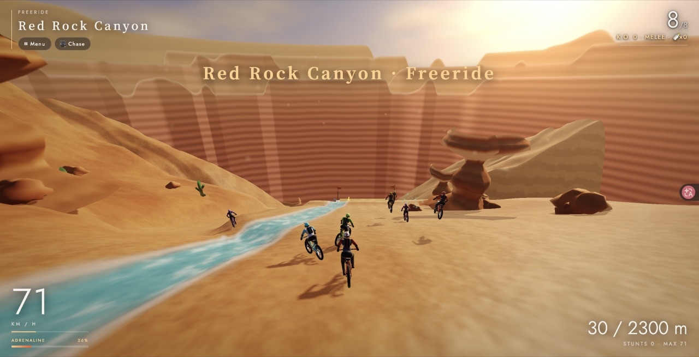
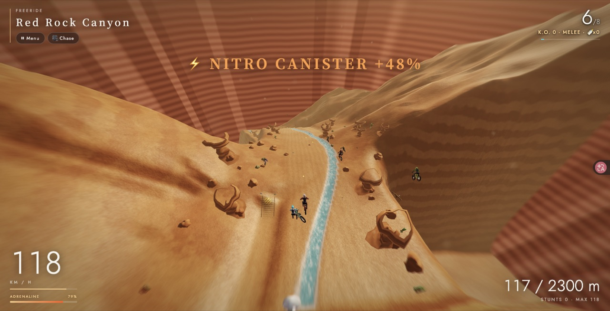
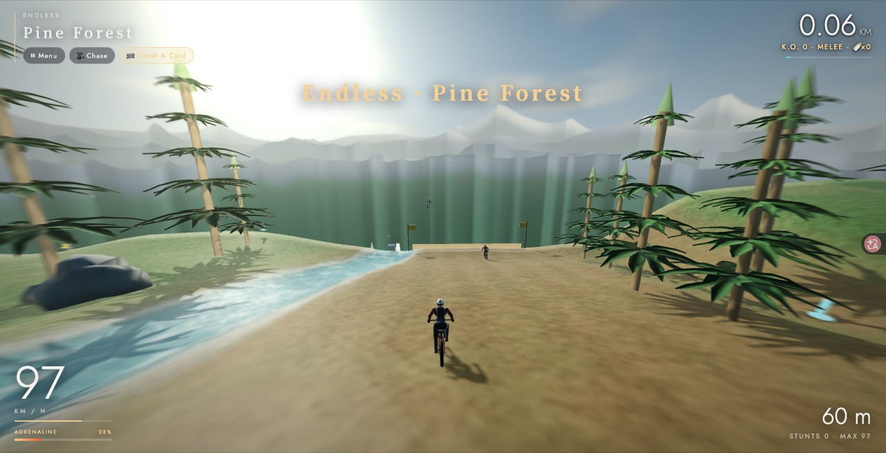
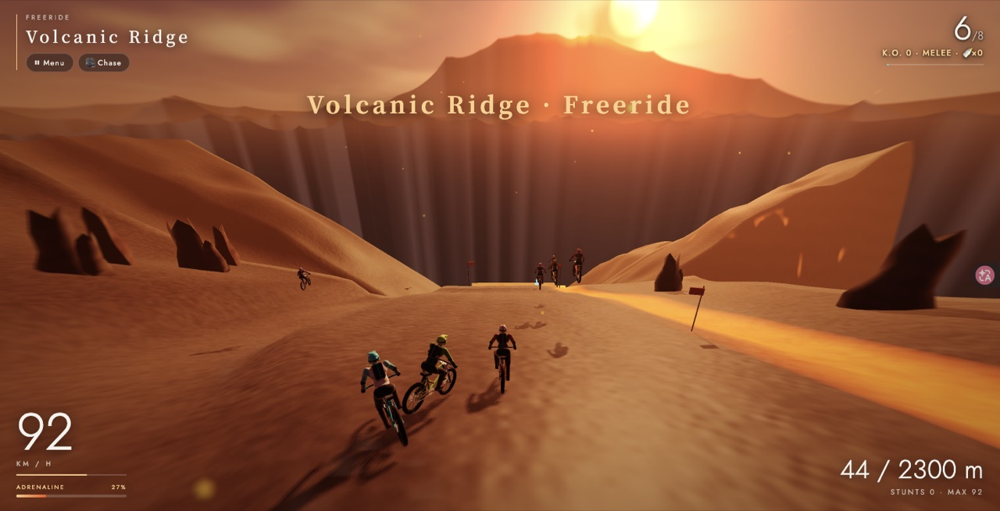
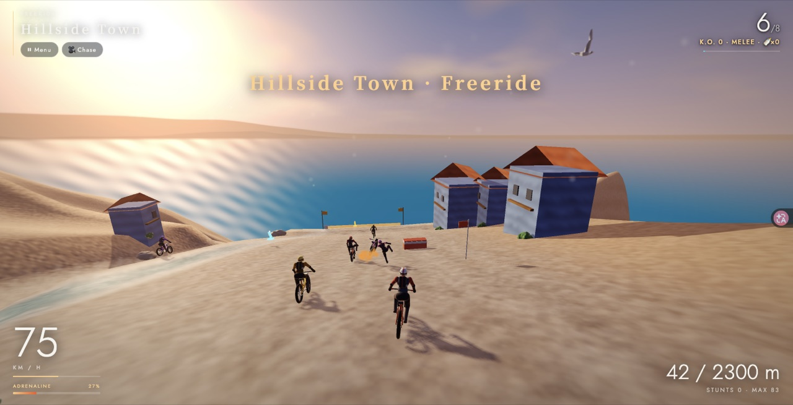
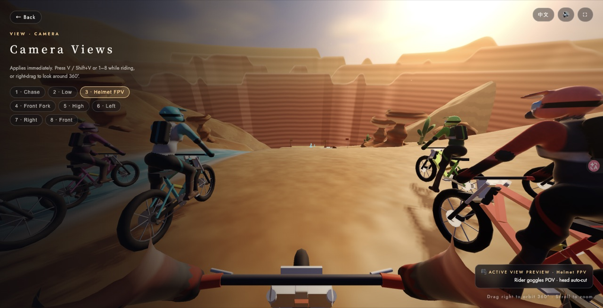

<div align="center">

<h1>CRAZYBIKE · 暴走山地速降</h1>

<p><strong>单文件双端渲染（WebGPU + WebGL2）程序化山地速降竞速游戏 —— 雕刻感峡谷与高山地形、无尽林道、高空彩带特技、道具驱动氮气与水壶对战、以及实时 3D 机位预览。</strong></p>

<p>
  <a href="https://crazybike.yepw.dev"><strong>在线试玩 (crazybike.yepw.dev)</strong></a>
  &nbsp;·&nbsp;
  <a href="README.md">English</a> | <strong>中文</strong>
</p>

<p>
  
  
  
  
</p>



</div>

---

## 核心特性

- **WebGPU + WebGL2 双渲染后端：** 内置单源强类型着色器语言（SSL），启动时实时编译为 WGSL 与 GLSL ES 3.00，提供清晰 PCF 定向阴影、物理瑞利/米氏大气散射、ACES 电影级色调映射与速度感泛光。
- **四大雕刻级程序化地貌：**
  - **红岩大峡谷（Red Rock Canyon）：** 层理砂岩方山、风蚀石林（Hoodoos）、棱柱仙人掌、峡谷溪流与多层速降断崖。
  - **苍翠松林道（Pine Forest）：** 冰雪覆盖花岗岩雪峰、山谷云海、下垂分层松枝、棱角巨石与无限边界速降。
  - **火山黑砂脊（Volcanic Ridge）：** 冒烟火山口与熔岩亮边、炽热岩浆河与锯齿玄武岩簇。
  - **悬崖山城（Hillside Town）：** 地中海岬角远景、海面波光粼粼、斜坡尖顶海滨小屋与盘旋海鸥。
- **道具刷新机制与拟真搏击动作：**
  - 废除无限水壶补给，改为沿飞跃台、断崖与赛道随机刷新的 **氮气罐** 与 **水壶** 拾取道具。
  - 水壶投掷严格限制有效追踪距离（`≤ 26 米`）；无水壶时按键随机触发 **人形直拳（Punch）** 或 **飞踹（Flying Kick）**，配合三阶段骨骼肢体动画与独立合成音效。
  - **严格击倒判定：** 普通擦碰与碰撞仅互相挤压避让（不摔车）；**仅当被飞踹或水壶命中时** 触发布娃娃击倒摔飞（可在设置中关闭），且起身复位会彻底清零特技残留角度，保证车体笔直恢复骑行。
- **零摔车连招特技与喷墨彩带：** 飞跃断崖时按顺序稳步做完当前动作再衔接下一招（`dblcancan → whip → backflip → cancan`），拖动自然笔刷质感喷墨彩带，落地无缝衔接蹬踏，消除弹跳循环。
- **实时 3D 机位预览与 8 大视角：** 在视角菜单中点击任意机位（追尾、贴地、头盔第一视角、前叉、俯瞰、左侧、右侧、正面），右侧画面立即切换实时预览并同步展示当前机位状态浮标；头盔视角自动遮罩头部网格，彻底杜绝穿模。
- **可交互场景动画与原生动物：** 擦碰草木、岩石时触发阻尼弹簧摇晃动画、对应生态碎屑粒子飞溅与撞击声效（碰撞障碍物不直接摔车）；远处低密度栖息盘旋飞鸟与奔跑四足野生动物。
- **内存感知画质与自适应 AI：** 根据设备内存、CPU 核心与 GPU 自动匹配低 / 均衡 / 高画质，7 名 AI 对手会基于玩家车辆改装等级与历史水平动态微调强/中/弱梯队节奏。
- **Lo-Fi 氛围音景：** Web Audio 实时合成沉浸式 Lo-Fi 节奏背景音轨、克制的风噪呼吸声、水壶/氮气拾取与踢拳打击声效。

---

## 四大山脉与界面实拍

<table>
  <tr>
    <td width="50%">
      
      <p align="center"><strong>红岩大峡谷</strong> —— 风蚀石林、沙丘灌木与赛道道具拾取</p>
    </td>
    <td width="50%">
      
      <p align="center"><strong>苍翠松林道</strong> —— 无限边界穿梭垂枝松林与远方雪峰</p>
    </td>
  </tr>
  <tr>
    <td width="50%">
      
      <p align="center"><strong>火山黑砂脊</strong> —— 冒烟火山口、熔岩河道与玄武岩尖峰</p>
    </td>
    <td width="50%">
      
      <p align="center"><strong>悬崖山城</strong> —— 山坡尖顶小屋、波光海湾与飞翔海鸥</p>
    </td>
  </tr>
</table>

<p align="center">
  
  <br>
  <em>视角机位实时 3D 预览与右下角状态说明浮标（头盔第一视角自动防穿模）</em>
</p>

---

## 操作指南

| 操作 | 按键 | 说明 |
| --- | --- | --- |
| **转向 / 蹬踏 / 刹车** | `WASD` / 方向键 | 压弯贴地俯冲、冲刺提速或入弯控速 |
| **跳跃起跳** | `Space` | 按住蓄力 · 松开从坡顶与断崖前沿腾空 |
| **空中连招特技** | `空中 WASD` / `Space` | 高空连续喷墨特技（做完再接下一招 · 零摔车） |
| **水壶 / 拳脚搏击** | `Q` `E` / `J` `K` | 有水壶则有限距离追踪投掷（≤26m），无道具时随机直拳或飞踹 |
| **肾上腺素暴走** | `Shift` | 消耗肾上腺素或氮气道具加速冲刺 |
| **切换视角机位** | `V` / `Shift+V` / `1`–`8` | 切换 8 大机位，或在“视角”菜单点击实时 3D 预览 |
| **360° 环视 / 暂停** | 右键拖拽 / `Esc` | 随时观察环境与机位，或呼出暂停菜单 |
| **中英语言切换** | 顶部 `EN / 中文` | 实时切换界面语言 |

---

## 本地构建与运行

依赖 Node.js（Node 20+，无需安装任何第三方 npm 包）：

```bash
# 开发构建并运行全部 19 项自动化校验
node build.js && npm run verify

# 压缩构建生产单文件 -> dist/index.html (335.6 KB)
MIN=1 node build.js

# 启动本地 8080 端口服务（访问 ?backend=webgl2 可强制测试 WebGL2 回退后端）
npm start
```

---

## 工程结构（`src/` 共 `28` 个源码模块）

| 模块范围 | 核心职责 |
| --- | --- |
| `00a_i18n.js` – `00c_quality.js` | 中英双语词库、Lo-Fi 调式配乐表、内存/硬件自适应画质分级器 |
| `01_gfx.js` – `02_shaderlib.js` | `WebGPU` + `WebGL2` 统一抽象层与 SSL → WGSL / GLSL ES 3.00 转译器 |
| `03_course.js` – `05_sky.js` | 4 大山脉随机地形、溪流、U 形坡、断崖道具点位及 4 层远景山岚 |
| `06_bikemesh.js` – `06b_rider_anim.js` | 11,181 顶点 SDF 车手模型、三段式直拳/飞踹人体骨骼及雕塑性环境物体网格 |
| `07_physics.js` – `09_combat.js` | 坡度自适应物理、摔倒笔直复位、8 机位相机、连招系统与水壶/拳脚战斗 |
| `10_particles.js` – `15_wildlife.js` | 喷墨彩带、生态碎屑、碰撞弹性摇晃（`Props.onHit`）、水花粒子及写实动物 |
| `16_career.js` – `99_main.js` | 12 场生涯赛事、车库升级、Web Audio 音频合成、UI 系统及主循环集成 |

`tools/verify-mvp.js` 在无头 Node.js 环境中对全套管线编译、SDF 建模、四大生态完整跑道审计、相机净空与预览、特技连招、无尽模式、水壶/拳脚严格击倒规则、音效平衡与障碍物受击动画执行全自动回归检查。
